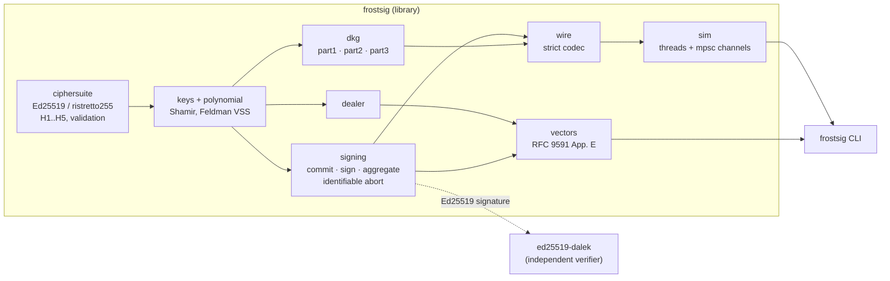

# frostsig

[](https://github.com/SlateGitOrg/frostsig/actions/workflows/ci.yml)

FROST threshold Schnorr signatures, as specified in RFC 9591, over Ed25519 and
ristretto255, written in Rust on top of `curve25519-dalek`. It covers trusted-dealer
and distributed key generation, two-round signing with nonce commitments, aggregation,
and share verification for identifiable aborts. A `t`-of-`n` group produces one
ordinary Ed25519 signature that any RFC 8032 verifier accepts.

> **Disclaimer.** frostsig is an educational implementation. **It has not been audited.**
> It is checked against the RFC 9591 test vectors and an independent Ed25519 verifier,
> but it has no secure transport, stores key shares in plaintext files, and makes no
> side-channel guarantees beyond those of `curve25519-dalek`. Do not use it to protect
> real assets. See [`docs/THREAT_MODEL.md`](docs/THREAT_MODEL.md).

## Why

A threshold signature lets any `t` of `n` key holders sign together, while fewer than
`t` learn nothing and cannot sign. FROST needs only two rounds and outputs a plain Schnorr
signature, so verifiers cannot tell that a threshold was involved. That makes it useful
for wallet custody, release signing, and certificate authorities.

frostsig is for engineers who want to see the whole protocol working: every
RFC 9591 function maps to a named Rust function (see
[`docs/ARCHITECTURE.md`](docs/ARCHITECTURE.md)), and every published intermediate value
is recomputed from the RFC's own test vectors. A thread-per-participant simulator shows
what happens when someone misbehaves.

## Features

- Two RFC 9591 ciphersuites: `FROST(Ed25519, SHA-512)` and `FROST(ristretto255, SHA-512)`.
- Key generation:
  - **trusted dealer**: Shamir sharing with a Feldman VSS commitment (Appendix C);
  - **DKG**: Pedersen DKG with Feldman VSS and Schnorr proofs of knowledge (the KeyGen
    from the FROST paper), so no party ever holds the group secret.
- Two-round signing with hedged nonces (`H3(random || sk_i)`). The type system enforces
  single use: `SigningNonces` is consumed by `sign`.
- Aggregation that verifies the result. On failure it runs `verify_signature_share` for
  every signer and returns `InvalidSignatureShares { culprits }` (identifiable abort).
- Standard Ed25519 output, cross-checked against `ed25519-dalek`'s `verify_strict`.
- A strict binary wire format. Every element goes through `DeserializeElement`, which
  rejects identity, small-order and non-canonical points.
- A simulator where each participant is a thread talking over local channels. Faults can
  be injected (bad share, silent signer, bad DKG share, forged proof, equivocation), and
  the coordinator identifies the culprits, excludes them, and retries.
- A CLI with `simulate`, `keygen`, `sign`, `verify`, `vectors` and `bench`.

## Architecture



[`docs/ARCHITECTURE.md`](docs/ARCHITECTURE.md) covers each module, its RFC section, the
signing sequence diagram, validation rules, and the complexity of every phase.

## Quick start

Requires a stable Rust toolchain (CI uses current stable). `make check` also needs `cargo-llvm-cov`.

```sh
make check          # fmt + clippy -D warnings + rustdoc -D warnings + tests + coverage >= 80%
make demo           # offline end-to-end demo (output below)
cargo run --release -- vectors
cargo run --release -- simulate --keygen dkg -t 3 -n 5 --fault 2=bad-share -m "hello"
```

As a library:

```rust
use std::collections::BTreeMap;
use frostsig::{dealer, signing, Ed25519Sha512};

let mut rng = rand_core::OsRng;
let (shares, public) = dealer::trusted_dealer_keygen::<Ed25519Sha512, _>(2, 3, &mut rng)?;
let keys: BTreeMap<_, _> = shares.into_iter()
    .map(|(id, s)| Ok((id, s.verify()?)))            // Feldman VSS check
    .collect::<frostsig::Result<_>>()?;

// Round 1: signers 1 and 3 commit.
let (mut nonces, mut comms) = (BTreeMap::new(), BTreeMap::new());
for id in keys.keys().filter(|id| id.to_u16() != Some(2)) {
    let (n, c) = signing::commit(keys[id].signing_share(), &mut rng);
    nonces.insert(*id, n);
    comms.insert(*id, c);
}
// Round 2 + aggregation.
let package = signing::SigningPackage::new(comms, b"hello".to_vec());
let shares: BTreeMap<_, _> = nonces.into_iter()
    .map(|(id, n)| Ok((id, signing::sign(&package, n, &keys[&id])?)))
    .collect::<frostsig::Result<_>>()?;
let sig = signing::aggregate(&package, &shares, &public)?;  // names cheaters on failure
assert!(frostsig::compat::dalek_verify_strict(
    &public.verifying_key().serialize()?, b"hello", &sig.to_bytes()?));
```

The same example runs as a doctest in `src/lib.rs`.

### CLI

| Command | Purpose |
|---|---|
| `frostsig simulate [--suite ed25519\|ristretto255] [-t T] [-n N] [--keygen dealer\|dkg] [--signers 1,3] [-m MSG]... [--fault ID=KIND]... [--seed S] [--json]` | Run key generation and signing sessions with every participant on its own thread |
| `frostsig keygen ... --out DIR` | Write `group.json` and `participant-<i>.json` (mode 0600, **plaintext shares**) |
| `frostsig sign --keys DIR -m MSG [--signers ...]` | Sign with whichever key files are present |
| `frostsig verify --suite S --public-key HEX -m MSG --signature HEX` | Verify with frostsig and, for Ed25519, with ed25519-dalek |
| `frostsig vectors` | Recompute RFC 9591 Appendix E |
| `frostsig bench [--sizes 4,8,...]` | Time every phase as `n` grows |

Fault kinds: `bad-share`, `silent`, `bad-proof`, `bad-dkg-share:<victim>`, `equivocate`.
Set `RUST_LOG=debug` to trace each protocol step.

## Usage example

Excerpt from `make demo` on a real run (seeded, so it reproduces exactly; step 1's 47
vector lines are shortened here):

```text
==== 1. RFC 9591 Appendix E test vectors ====
FROST(Ed25519, SHA-512) (RFC 9591 Appendix E)
  [PASS] group_public_key
  [PASS] P1 participant_share
  ...
  [PASS] aggregate sig
  [PASS] verify (frostsig)
  [PASS] verify (ed25519-dalek, strict)
FROST(ristretto255, SHA-512) (RFC 9591 Appendix E)
  ...
47 of 47 checks passed

==== 2. 3-of-5 DKG, then two signing sessions (Ed25519, checked by ed25519-dalek) ====
frostsig is educational software: unaudited, not for real assets.
suite      : FROST(Ed25519, SHA-512)
threshold  : 3-of-5
keygen     : dkg
group key  : 29eff10fcd8246fdf74f423d467b16496f0ab1c228b5cc7a55a4f43e07124f64
session 0  : message "release v1.2.0"
  attempt 0: signers [P1, P2, P3] -> signature aggregated
  signature: 2601c7f6beac23d0bcb93ead5a038bd942c537643a479e9ad4ba21ef304cce043a7a1f7e8c0739260d490fa493a864cf9250218a2b85cfe450f61485ce7bd10c
  verify (frostsig)          : OK
  verify (ed25519-dalek strict): OK
session 1  : message "rotate staging key"
  attempt 0: signers [P1, P2, P3] -> signature aggregated
  signature: 07fbf408cb25aa1ee6c78af9204fb22111a3826b0faa568f920ba2867d9d42fae7b563575e39f29bfa573277de3e1ae8359bedc107fafe5afd6f7ccb451bdd01
  verify (frostsig)          : OK
  verify (ed25519-dalek strict): OK
traffic    :
  control/shutdown              5 msgs       25 bytes
  keygen/dkg-round1            20 msgs     3340 bytes
  keygen/dkg-round2            20 msgs      740 bytes
  keygen/ready                  5 msgs     1810 bytes
  sign/commit-request           6 msgs       54 bytes
  sign/round1-commitments       6 msgs      438 bytes
  sign/round2-package           6 msgs     1914 bytes
  sign/round2-share             6 msgs      246 bytes

==== 3. Identifiable abort: P2 sends a bad signature share; the coordinator excludes it and retries ====
suite      : FROST(ristretto255, SHA-512)
threshold  : 3-of-5
keygen     : trusted-dealer
faults     : P2=bad-share
group key  : 76cec921af0eedf03718ee7dd2c82fe0d58484cf7dc7935bb67bb8cd4a074b75
session 0  : message "approve payout #42"
  attempt 0: signers [P1, P2, P3] -> identifiable abort: invalid signature share from [P2]
  attempt 1: signers [P1, P3, P4] -> signature aggregated
  signature: 1c0e1f875056795b722e1a197f976919e57a1cbc519eda74d81842f0631a4e196162267e7a360ccdf5498cdd6029b2538394840e6a909c8993663878f64d6907
  verify (frostsig)          : OK

==== 5. DKG abort: P3 sends P1 a share that fails Feldman verification ====
keygen     : ABORTED
  P1 complains [P3]: DKG: invalid secret shares from participants 3
  identified culprits: [P3]

==== 6. DKG equivocation: P1 shows different commitments to odd and even peers ====
keygen     : INCONSISTENT group views (broadcast was not consistent)
  770b4762edb66ec10af101c8a1378c69922a99c7f4596c61a200808c36a12d54 held by [P1, P3]
  8a00b3c366a62901ac51eb5ef14e7bc2b4bd0cb36f1a004569ad27b4bb47c053 held by [P2, P4]

==== 7. keygen -> files -> sign with two of three holders -> verify ====
FROST(Ed25519, SHA-512) 2-of-3 group via dkg
group public key: bfbcb8ed67e9d8be4b49f6a2fdc503f6bd0e3ce3c957fed3913cca538d1be8b8
signers: 2,3
signature : 943eeb3570479e55f167cf5e41535a4b57e2e66b4b13405131085af6a4d06d2a34e7fcb70980e9be478fa6d1100646d269a86e2be3d26c5a79722fa8bd75d300
verify (frostsig, FROST(Ed25519, SHA-512)): OK
verify (ed25519-dalek strict): OK
tampered message:
verify (frostsig, FROST(Ed25519, SHA-512)): FAILED
  reason: signature verification failed
verify (ed25519-dalek strict): FAILED
(rejected, exit 1)
```

## Design decisions

The full list, each with its cost if wrong, is in [`DECISIONS.md`](DECISIONS.md). The
main ones:

- **One RFC function, one Rust function, generic over the ciphersuite.** The two suites
  share curve25519's scalar field, so only the group element, its encoding and `H2`
  differ.
- **Validation lives at the decode boundary.** Ed25519 decoding also rejects
  non-canonical `y` and the `x = 0` sign-bit encoding, which RFC 8032 forbids but
  curve25519-dalek accepts. Identifier lists must be strictly ascending, so every
  package has exactly one encoding. The mutation property test caught a violation of
  this during development.
- **O(t) share verification.** `SigningSession` computes binding factors, `R` and `c`
  once per session. Calling the RFC's `verify_signature_share` once per signer would redo
  that work, giving O(t²).
- **Two independent verifiers.** This crate's own verifier uses the cofactored equation
  that RFC 9591 section 6.1 mandates. `ed25519-dalek`'s `verify_strict` provides the
  interoperability check.
- **The DKG follows the FROST paper**, with proofs of knowledge bound to the
  participant's identifier, so a replayed proof fails. RFC 9591 does not specify a DKG.

## Testing

All numbers below were produced by the commands shown next to them.

**Tests.** Unit tests in each module, RFC vector tests, property tests (proptest) and
end-to-end simulation and CLI tests:

```sh
make test
```

- 66 unit tests;
- 3 RFC-vector tests: 47 recomputed values, including both final signatures and the
  `ed25519-dalek` check;
- 9 property tests: random `(t, n)` with `2 <= t <= n <= 10`, random signer subsets of
  size `t..=n`, random sets of cheaters, a decoder fuzz over random and mutated bytes,
  and every 3-subset of a 3-of-5 group;
- 12 simulation tests;
- 7 CLI tests;
- 1 doctest.

**Coverage.** `make coverage` (`cargo llvm-cov --all-targets --fail-under-lines 80`)
reports **95.8% line coverage** (3,225 lines, 136 missed) over the library and the CLI.
The least-covered file is `sim/participant.rs` at 72%, where the uncovered lines are
timeout and malformed-message paths.

**Benchmarks vs n.** `make bench-table`, which runs `frostsig bench --suite ed25519 --sizes
4,8,16,32,64,128 --iterations 15 --dkg-max-n 64`. These are release-build medians on an
Apple M1 Pro, single-threaded, measured while other builds were running (load average
about 5), so expect ±20% noise:

| n | t | dealer keygen | DKG / participant | commit (1 signer) | sign (1 signer) | aggregate | aggregate + verify all shares | verify |
|---:|---:|---:|---:|---:|---:|---:|---:|---:|
| 4 | 3 | 148 µs | 442 µs | 30 µs | 94 µs | 130 µs | 304 µs | 48 µs |
| 8 | 6 | 345 µs | 1.01 ms | 29 µs | 138 µs | 174 µs | 514 µs | 47 µs |
| 16 | 11 | 819 µs | 2.36 ms | 29 µs | 218 µs | 247 µs | 883 µs | 47 µs |
| 32 | 22 | 2.62 ms | 6.60 ms | 29 µs | 394 µs | 431 µs | 1.82 ms | 46 µs |
| 64 | 43 | 10.96 ms | 24.70 ms | 28 µs | 728 µs | 792 µs | 3.69 ms | 46 µs |
| 128 | 86 | 58.45 ms | - | 30 µs | 1.46 ms | 1.45 ms | 8.63 ms | 47 µs |

`t = ceil(2n/3)`, and every session uses exactly `t` signers. Commit and verify cost the
same at every `n`. Sign and aggregate grow linearly with the signer count, through the
binding-factor hashing and the `2t`-point multi-scalar multiplication. DKG work per
participant grows as O(n·t). Always verifying every share costs 2 to 6 times a
plain aggregate. Criterion versions of these benchmarks run with `make bench`.

**Size.** `./scripts/loc.sh` reports 4,687 lines of shipped source and 1,792 lines of tests
and benches (both counts include comments and blank lines).

## Limitations

- **Not audited, not constant-time verified.** Secret-dependent operations use
  curve25519-dalek's constant-time code, but nobody has measured this crate for timing
  leaks. Plaintext key files and seeded RNG modes exist for demos only.
- **DKG broadcast is not reliable.** It is simulated as point-to-point sends.
  Equivocation is detected afterwards, when the coordinator compares group views, but it
  is not attributed to anyone. A real deployment needs echo broadcast or a bulletin board.
- **DKG complaints are not adjudicated.** A participant who receives a bad share names
  the sender, but the accused cannot publicly reveal the share to defend itself, so a
  malicious accuser could frame an honest peer. The RFC's signing-phase identifiable abort
  has no such gap, because it relies only on public data.
- **No transport security.** The simulator models authenticated channels within a single
  process. There is no networking, TLS, or encryption of DKG and dealer shares.
- **Not robust.** As FROST itself is not, an absent or misbehaving signer forces a retry.
  The coordinator's exclude-and-retry policy is a simple heuristic: slow-but-honest
  signers get blamed when they time out.
- **Signers sign whatever the coordinator sends.** There is no message-policy hook
  (RFC 9591 section 7.7).
- **The wire format is this project's own.** RFC-defined values (scalars, elements,
  signatures) are byte-compatible with other implementations, but the packaging around
  them is not interoperable. The DKG messages have no cross-implementation test vectors.
- **Only two suites.** Ed448, P-256 and secp256k1 are not implemented.
- **Benchmark numbers come from a shared, loaded laptop.** Run `make bench-table` on
  your own machine.

## Roadmap

- Echo broadcast for DKG round one, and a complaint and justification phase.
- Share refresh and repair (proactive security) and a `KeyPackage` rotation command.
- Batch verification of signature shares, and batch inversion for Lagrange coefficients.
- An optional message-policy callback for participants (RFC 9591 section 7.7).
- A networked transport (TCP with mutual TLS) behind the same `Endpoint` interface.
- Cross-implementation tests against the Zcash Foundation `frost-ed25519` crate.

## Project layout

```
src/            library (ciphersuite, keys, dealer, dkg, signing, wire, sim, ...) + CLI (main.rs)
tests/          RFC vectors, property tests, simulation and CLI integration tests
benches/        criterion benchmarks vs n
vectors/        RFC 9591 Appendix E excerpts (see DATA.md)
scripts/        demo.sh, extract-vectors.sh, loc.sh
docs/           ARCHITECTURE.md, THREAT_MODEL.md
```

CI (`.github/workflows/ci.yml`) runs `make check`, `make demo`, and a check that the
bundled vectors still match the published RFC text.

## License

MIT — see [LICENSE](LICENSE). The RFC 9591 test-vector excerpts are © IETF Trust (see
[DATA.md](DATA.md)).
