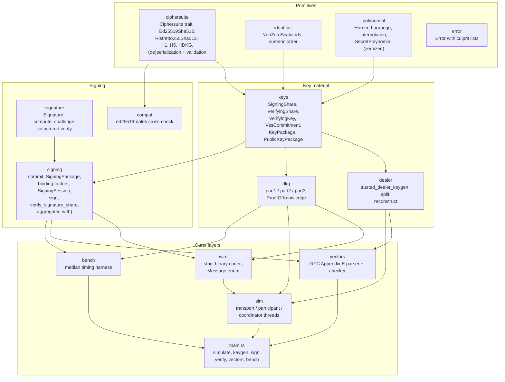
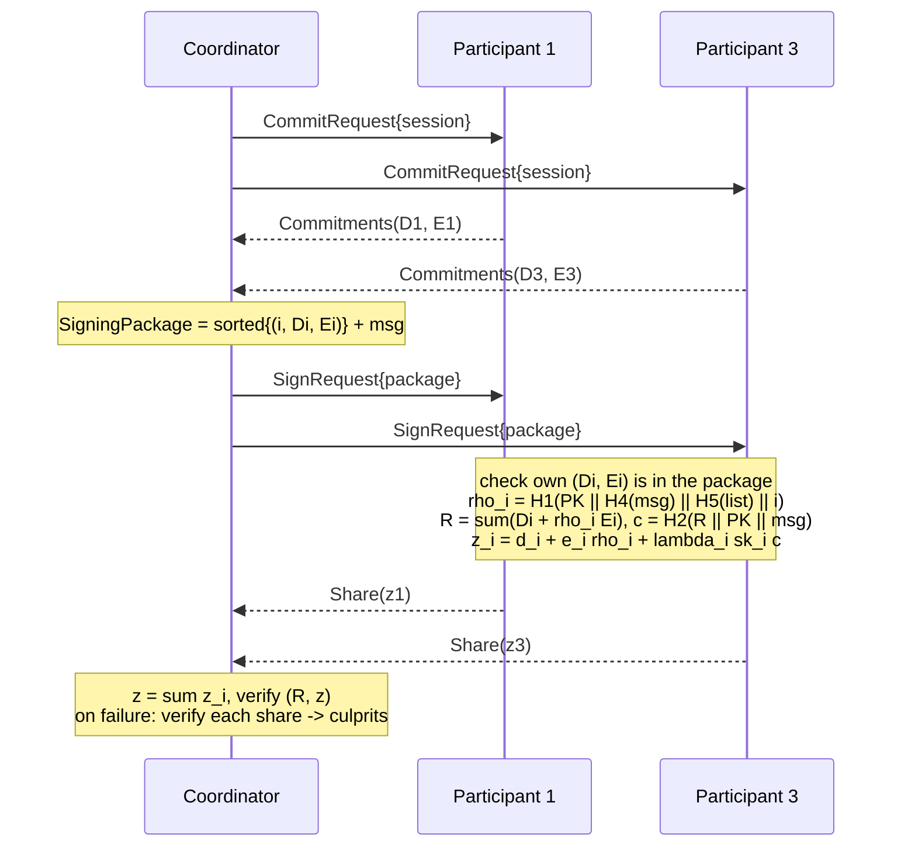

# Architecture

frostsig is a single Rust crate with a library (`src/lib.rs`) and a CLI binary
(`src/main.rs`). The library follows the structure of RFC 9591. Each RFC function is
implemented once, generically over the `Ciphersuite` trait, and both suites reuse it.

## Module map

| Module | RFC 9591 section | Responsibility |
|---|---|---|
| `ciphersuite` | 3.1, 3.2, 6.1, 6.2 | The group abstraction, hash functions H1 to H5, element and scalar encodings with full input validation |
| `identifier` | 3.1 (NonZeroScalar) | Participant ids, ordered by numeric value as the commitment-list ordering requires |
| `polynomial` | 4.2, C.1, C.1.1 | `polynomial_evaluate`, `derive_interpolating_value`, `polynomial_interpolate_constant` |
| `keys` | 5 (group info), C.2 | `vss_commit`, `vss_verify`, `derive_group_info`, and the key and public packages |
| `dealer` | C, C.1 | `trusted_dealer_keygen`, `secret_share_shard`, `secret_share_combine` |
| `dkg` | (not in the RFC) | Pedersen DKG with Feldman VSS and proofs of knowledge |
| `signing` | 4.1, 4.3 to 4.5, 5.1 to 5.4 | `nonce_generate`, `commit`, `encode_group_commitment_list`, `compute_binding_factors`, `compute_group_commitment`, `sign`, `aggregate`, `verify_signature_share` |
| `signature` | 4.6, A, B | `compute_challenge`, the encoding, cofactored and prime-order verification, `prime_order_sign` |
| `compat` | 6.1 | Independent RFC 8032 verification through `ed25519-dalek` |
| `wire` | 5 ("MUST be deserialized") | Message framing and canonical encodings |
| `vectors` | E | Recomputation of every published intermediate value |
| `sim` | 5, 5.4, 7.5 | Multi-threaded deployment model with fault injection |

## Signing data flow

Every arrow is a `wire::Message` encoded to bytes, sent over an `mpsc` channel and
decoded on arrival with full validation. The transport stamps the sender's `NodeId`
itself, so a participant cannot claim to be someone else. That is the authenticated
channel FROST needs for identifiable abort.

## Key algorithms and complexity

`n` is the number of participants, `t` the threshold (and the size of the signer set in
the bounds below), `M` the time for one scalar multiplication.

| Operation | Cost | Notes |
|---|---|---|
| `trusted_dealer_keygen` | O(n·t) field ops + O(t) M for the commitment + O(n·t) M for `derive_group_info` | Verifying shares come from one multi-scalar multiplication each, `sum_j C_j * i^j` |
| `dkg::part1` | O(t) M | `t` coefficient commitments plus the proof of knowledge |
| `dkg::part2` | O(n) M | One proof check per peer, then O(n·t) field ops for shares |
| `dkg::part3` | O(n·t) M | `n-1` Feldman checks of `t` terms each, plus deriving `n` verifying shares |
| `commit` | 2 base mults | Hedged nonces: `H3(32 random bytes || sk_i)` |
| `sign` | O(t) hashing + one 2t-point multi-scalar mult + O(t) field ops | Binding factors, `R`, `lambda_i`. Grows with the signer set, not with `n` |
| `aggregate` (OnFailure) | Same as one `sign` + 1 verification | Shares are checked only if the signature fails |
| `aggregate` (Always) | + t × (1 base mult + one 3-point MSM) + O(t²) field ops | `SigningSession` computes binding factors, `R` and `c` once. The RFC's per-share `verify_signature_share` would redo them, giving O(t²) point operations |
| `verify` | 1 base mult + 1 variable-base mult + cofactor clear | Constant in `n` |

Measured numbers for all of these, as `n` grows, are in the README (`make bench-table`).

### Lagrange coefficients

`derive_interpolating_value(L, x_i)` returns `prod_{j != i} x_j / (x_j - x_i)` with one
inversion. It rejects `x_i` values not in `L` and duplicates (found with a `BTreeSet`,
O(n log n)). The coefficients over any signer set sum to 1, which a unit test checks.

### Group commitment

`R = sum_i (D_i + rho_i E_i)` is computed as one variable-time multi-scalar
multiplication over `2t` public points, the multi-exponentiation that RFC section 4.5
mentions. Secret-dependent multiplications (`base_mul` of nonces and shares) always use
dalek's constant-time code.

### Element validation (Ed25519)

`decode_element` does four things:
1. decompresses (RFC 8032 5.1.3);
2. recompresses and compares, rejecting `y >= p` and `x = 0` with the sign bit set;
3. rejects points outside the prime-order subgroup (`is_torsion_free`);
4. rejects the identity, in `deserialize_element`.

ristretto255's `Decode` is canonical by construction, so only the identity check is added.

## Error handling

Every fallible operation returns `frostsig::Error`. Variants that carry `culprits`
(`InvalidSignatureShares`, `InvalidProofOfKnowledge`, `InvalidDkgShares`) implement
identifiable abort. The simulator turns them into `Abort` messages and coordinator
exclusions. Library code never panics on input. The two `expect`s in `wire::Writer` cover
lengths that the types already bound (counts at most `u16::MAX`, messages at most 1 MiB).

## Logging

The library logs through the `log` facade: `debug!` for protocol steps and `warn!` for
identifiable aborts and DKG complaints. The CLI installs `env_logger` with a default level
of `error`, and `RUST_LOG=debug frostsig simulate ...` traces every step.

## Simulation internals

- `transport::network` builds one `mpsc` inbox per node and shares a `TrafficStats`
  table, which counts messages and bytes per message label.
- `participant::run` sets up keys (a dealer share verified with Feldman VSS, a 3-part
  DKG, or preloaded keys), reports `KeysReady(PublicKeyPackage)` to the coordinator, then
  serves commit and sign requests. Pending nonces are keyed by session id and removed when
  used.
- During the DKG a `DkgInbox` buffers round-two shares and complaints that arrive early.
  Complaints only end the wait in round two, so every honest participant judges round one
  for itself. That keeps fault attribution deterministic regardless of thread scheduling.
- `coordinator::run` collects key-setup reports (any complaint aborts; differing views
  mean `Inconsistent`). It then runs each message as a session of up to three attempts.
  Session ids are unique per attempt, so stale replies are ignored.
- Seeded runs are byte-for-byte reproducible, and the `seeded_runs_are_reproducible`
  test checks this. All collections that affect output are `BTreeMap`s, so thread
  interleaving cannot change the report.
